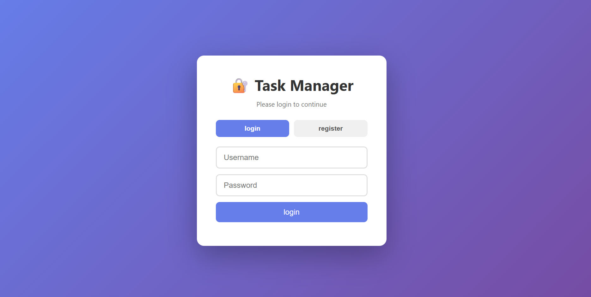
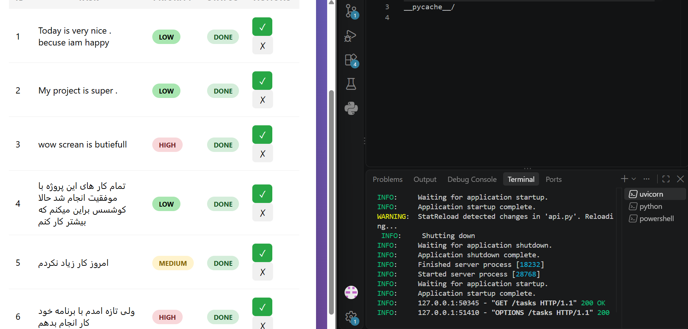

# 📝 Task Manager

A simple task manager built with **Python** — available both as a **command-line tool** and as a **REST API** built with **FastAPI**. Secured with JWT authentication.

---

## 🖼️ Screenshots

### 🔐 Login Page



### 📝 Task Manager



---

## ✨ Features

- ✅ Add new tasks with **priority** (low / medium / high)
- 📋 Show all tasks with their status and priority
- 🎯 **Filter** tasks by priority (All / High / Medium / Low)
- 📊 **Filter** tasks by status (All / Done / Pending)
- 🔍 **Search** tasks by title
- ↕️ **Sort** tasks by priority
- 🔁 Automatic **ID reset** after deletion (keeps IDs sequential)
- ✔️ Mark tasks as done
- 🗑️ Delete tasks
- 🧹 **Clear All** tasks (with confirmation)
- 🎨 Beautiful web UI (HTML + CSS + JavaScript)
- 💻 Command-line interface (CLI)
- 💾 Persistent storage with **SQLite**
- 🌐 Full **REST API** with automatic documentation (`/docs`)
- 🧪 Automated tests with **pytest**
- 🔐 **Authentication** with JWT (Register / Login)
- 🛡️ **Protected endpoints** — tasks require login
- 👤 **User-specific tasks** — each user sees only their own tasks

---

## 🛠️ Tech Stack

| Layer | Technology |
|-------|-----------|
| Language | Python 3.13 |
| Database | SQLite 3 |
| API Framework | FastAPI |
| ASGI Server | Uvicorn |
| CLI | Custom menu in `mains.py` |
| Authentication | JWT + bcrypt + passlib |
| Frontend | HTML + CSS + JavaScript |
| Version Control | Git + GitHub |

---

## 🔐 Authentication

The app uses **JWT (JSON Web Tokens)** for secure authentication.

### How it works

1. **Register** a new account at `/register`
2. **Login** at `/login` to receive a JWT token
3. Include the token in the `Authorization: Bearer <token>` header for all protected requests
4. Tokens expire after **60 minutes**

### Security features

- ✅ Passwords hashed with **bcrypt** (never stored in plain text)
- ✅ JWT tokens with expiration
- ✅ Protected endpoints return `401 Unauthorized` without a valid token
- ✅ Each user can only access their own tasks

### Example: Login

```bash
curl -X POST http://127.0.0.1:8000/login \
  -H "Content-Type: application/x-www-form-urlencoded" \
  -d "username=your_username&password=your_password"
```

**Response:**
```json
{
  "access_token": "eyJhbGciOiJIUzI1NiIsInR5cCI6IkpXVCJ9...",
  "token_type": "bearer"
}
```

---

## 📂 Project Structure

```
task-manager/
├── api.py              # FastAPI application (REST API)
├── auth.py             # Authentication (JWT + password hashing)
├── database.py         # Database layer (SQLite)
├── task_manager.py     # CLI helper functions
├── mains.py            # CLI entry point (menu)
├── requirements.txt    # Dependencies
├── tasks.db            # SQLite database (auto-generated)
├── frontend/           # Web UI (HTML + CSS + JS)
│   ├── index.html
│   ├── script.js
│   └── style.css
├── tests/              # Automated tests
│   ├── conftest.py
│   └── test_api.py
└── README.md
```

---

## 🚀 Getting Started

### 1. Clone the repository

```bash
git clone https://github.com/Yousufi93/task-manager.git
cd task-manager
```

### 2. Install dependencies

```bash
pip install -r requirements.txt
```

---

## 💻 Usage

You have **three ways** to use this app:

### 🖥️ Option A: Web UI (Recommended)

**Terminal 1** — start the API:
```bash
uvicorn api:app --reload
```

**Terminal 2** — start the web server:
```bash
cd frontend
python -m http.server 5500
```

Then open in your browser: **http://127.0.0.1:5500**

**Workflow:**
1. Click on **Register** and create a new account.
2. **Login** with your credentials.
3. Add, edit, search, and filter your tasks!

### 💻 Option B: Command-Line Interface (CLI)

```bash
python mains.py
```

You will see:

```
1. Add Task
2. Show Tasks
3. Mark Task as Done
4. Delete Task
5. Exit
```

### 🌐 Option C: REST API

```bash
uvicorn api:app --reload
```

Then open:
- **API root:** http://127.0.0.1:8000
- **Interactive docs (Swagger UI):** http://127.0.0.1:8000/docs
*(Note: Protected endpoints require you to click the "Authorize" 🔒 button and enter your token)*

---

## 🌐 API Endpoints

| Method | Endpoint | Description |
|--------|----------|-------------|
| `POST` | `/register` | Create a new user account |
| `POST` | `/login` | Login and receive a JWT token |
| `GET` | `/tasks` | List all tasks (protected) |
| `POST` | `/tasks` | Create a new task (protected) |
| `PATCH` | `/tasks/{id}/done` | Mark a task as done (protected) |
| `DELETE` | `/tasks/{id}` | Delete a task (protected) |
| `DELETE` | `/tasks` | Delete all tasks (protected) |

### Example requests

**Create a task with priority:**
```bash
curl -X POST http://127.0.0.1:8000/tasks \
  -H "Content-Type: application/json" \
  -H "Authorization: Bearer YOUR_TOKEN_HERE" \
  -d '{"title": "Buy milk", "priority": "high"}'
```

**Mark task 1 as done:**
```bash
curl -X PATCH http://127.0.0.1:8000/tasks/1/done \
  -H "Authorization: Bearer YOUR_TOKEN_HERE"
```

**Delete task 1:**
```bash
curl -X DELETE http://127.0.0.1:8000/tasks/1 \
  -H "Authorization: Bearer YOUR_TOKEN_HERE"
```

---

## 🎓 What I Learned

This is my first full Python project. Through building it, I learned:

- Writing **functions**, **loops**, and **modules** in Python
- Working with **SQLite** databases (CRUD operations)
- Building a **REST API** with **FastAPI**
- Using **Pydantic** for data validation
- Handling **HTTP methods** (GET, POST, PATCH, DELETE) and **status codes** (200, 401, 404, 422)
- Building a **web UI** with HTML, CSS, and JavaScript
- Implementing **filter, search, and sort** in the frontend
- Securing APIs with **JWT Authentication**
- Using **bcrypt** for password hashing
- Using **Git & GitHub** for version control

---

## 📌 Future Improvements

- [ ] Add task due dates and reminders
- [ ] Add user profile management
- [ ] Build a mobile app (React Native)
- [ ] Migrate to PostgreSQL for production
- [ ] Dockerize the application

---

## 📄 License

This project is for learning purposes. Feel free to use it.